# Land-Cover Classification of Sentinel-2 Multispectral Imagery

Scene-level land-use / land-cover classification of **Sentinel-2** satellite patches with all **13 spectral bands** (EuroSAT: 27,000 patches of 64 × 64 px at 10 m, 10 classes). The project compares a classical **statistical pattern recognition** pipeline (spectral statistics, spectral indices and Haralick texture with a Gaussian maximum-likelihood classifier, a random forest and an SVM) with **CNNs adapted to multispectral input**. All models are evaluated with confidence intervals and significance tests, and the project measures how much the usual random train/test split overestimates accuracy compared with a **geographically disjoint** test region.

<p align="center">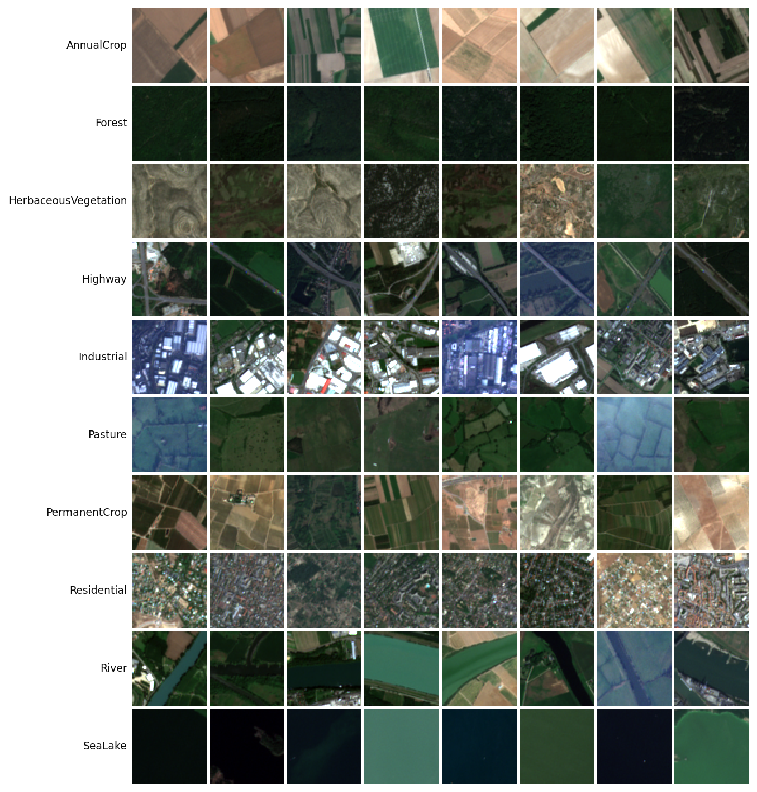</p>
<p align="center"><sub>EuroSAT: eight random Sentinel-2 patches per class (true color, 64 × 64 px = 640 m × 640 m on the ground).</sub></p>

<p align="center">
  <b>98.70% test accuracy on EuroSAT (5,400 test images)</b> with an ImageNet ResNet-18 inflated to 13 bands<br>
  best hand-crafted pipeline: 95.31% · same network on RGB only: 97.74%<br>
  on a test region ~1,000 km from the training data: 96.24% with 13 bands vs. 91.65% with RGB<br>
  the whole notebook runs in 26 minutes on a laptop RTX 3050 (6 GB)
</p>

**Notebook:** [`sentinel2_land_cover_classification.ipynb`](sentinel2_land_cover_classification.ipynb) runs top to bottom, and all outputs are included.

## Highlights

- **From raw GeoTIFFs.** The 27,000 13-band GeoTIFFs are read straight from the archive. Their georeferencing (UTM tie points) is converted to longitude/latitude to map the samples, and the band order is verified physically: the cirrus band B10 must be close to zero over land.
- **Understanding the data before modelling.** Spectral signatures per class, NDVI / NDWI / NDBI, true-color, color-infrared and SWIR composites, band correlations and PCA.
- **Physically motivated augmentation on the GPU.** The dihedral group D4 (nadir images have no "up") plus radiometric jitter applied to reflectances, before standardization.
- **Statistical pattern recognition baseline.** 42 features (per-band statistics, spectral indices, Haralick GLCM texture) classified with Gaussian ML (QDA), a random forest and an RBF-SVM, plus a feature-group ablation and permutation importance.
- **CNNs for 13-band input.** A compact spectral–spatial CNN trained from scratch, and an ImageNet ResNet-18 whose first convolution is inflated from 3 to 13 bands (checked numerically) and whose max-pooling is removed for the 64 px input.
- **Controlled ablations, statistically tested.** RGB vs. 13 bands, ImageNet vs. random initialization, augmentation, architecture and test-time augmentation, evaluated with OA, macro-F1, Cohen's κ, bootstrap confidence intervals and McNemar's test with Holm correction.
- **Interpretation.** Band permutation importance (overall and per class), Grad-CAM, t-SNE of hand-crafted vs. learned features, and error analysis.
- **Content-based image retrieval.** Precision@10 is 98.6% with the learned features vs. 87.1% with the hand-crafted ones.
- **Spatial generalization.** Random vs. spatially disjoint (west → east) evaluation.

## Data

<p align="center">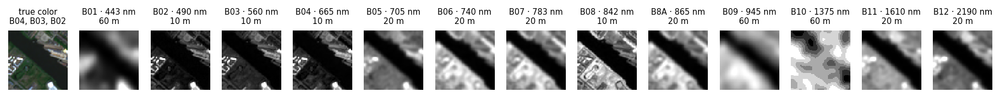</p>
<p align="center"><sub>One River patch in all 13 bands, sorted by wavelength: the 60 m bands (B01, B09, B10) are much coarser, and in the near and shortwave infrared the water is black while the land is bright.</sub></p>

<p align="center">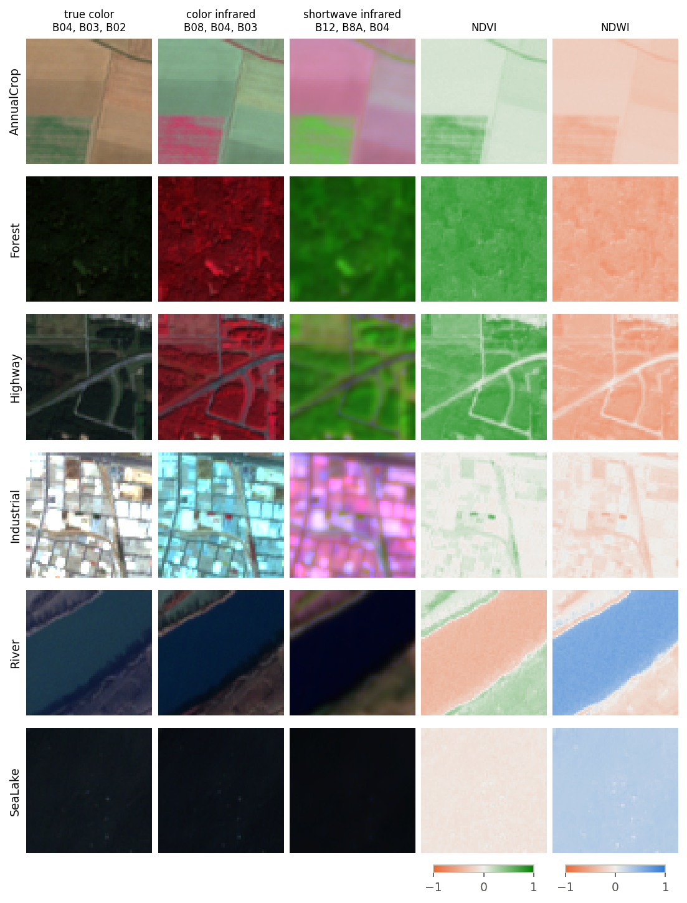</p>
<p align="center"><sub>True-color, color-infrared and shortwave-infrared composites with NDVI and NDWI: vegetation is bright in the near infrared (red in color infrared), water is black.</sub></p>

## Results

| model | input | test OA, random split (95% CI) | macro-F1 | test OA, spatial split |
|---|---|---|---|---|
| Gaussian ML (QDA), hand-crafted | 42 features | 90.83% (90.09–91.59) | 90.19% | – |
| Random forest, hand-crafted | 42 features | 92.43% (91.74–93.11) | 92.03% | 84.85% |
| RBF-SVM, hand-crafted | 42 features | 95.31% (94.74–95.87) | 95.05% | – |
| SpectralSpatialCNN (from scratch, 0.6 M) | 13 bands | 95.93% (95.37–96.44) | 95.78% | – |
| ResNet-18 (random initialization) | 13 bands | 97.91% (97.50–98.28) | 97.85% | – |
| ResNet-18 (ImageNet) | B04, B03, B02 | 97.74% (97.33–98.11) | 97.77% | 91.65% |
| ResNet-18 (ImageNet), no augmentation | 13 bands | 98.57% (98.26–98.89) | 98.53% | – |
| **ResNet-18 (ImageNet)** | **13 bands** | **98.70% (98.39–99.00)** | **98.67%** | **96.24%** |
| + test-time augmentation (D4) | 13 bands | 98.80% (98.50–99.07) | 98.76% | – |

McNemar's test (Holm-corrected) on the random split: 13 bands vs. RGB, ImageNet vs. random initialization, ResNet-18 vs. the compact CNN, and CNN vs. SVM are all significant (p < 10⁻⁴). Augmentation (p = 0.66) and test-time augmentation (p = 0.66) are not.

<p align="center">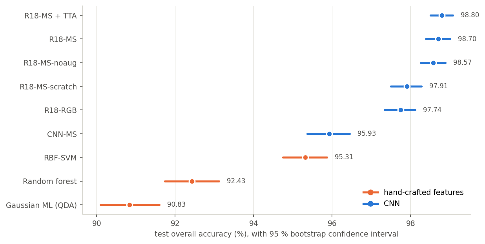</p>

## Example outputs

<p align="center">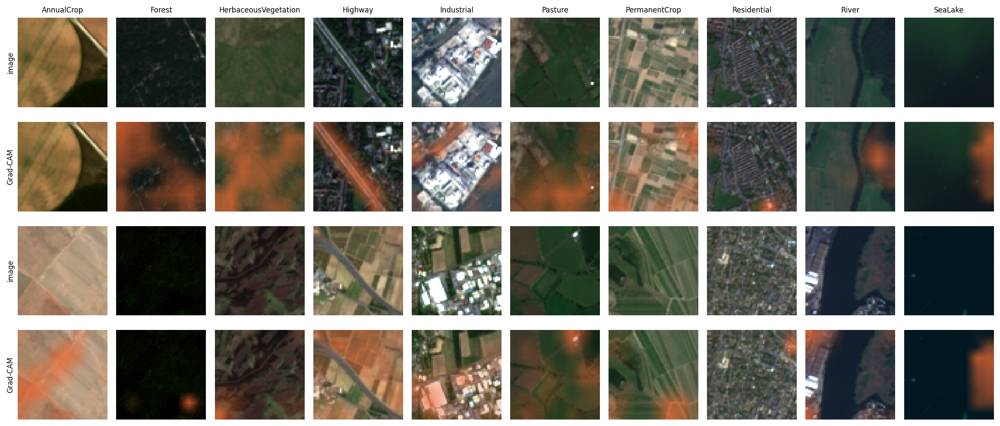</p>
<p align="center"><sub>Grad-CAM of the 13-band ResNet-18 on two random test images per class (all classified correctly): the maps often follow roads, riverbanks and buildings.</sub></p>

<p align="center">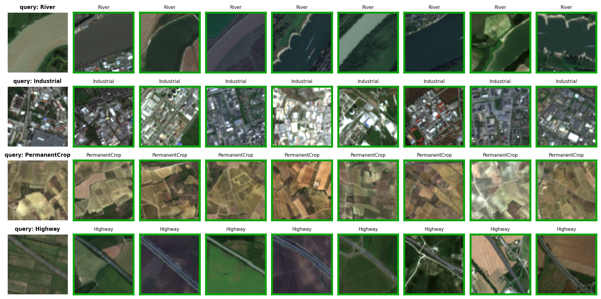</p>
<p align="center"><sub>Image retrieval with the CNN features: a test query (left) and its eight most similar training images, all from the query's class.</sub></p>

<p align="center">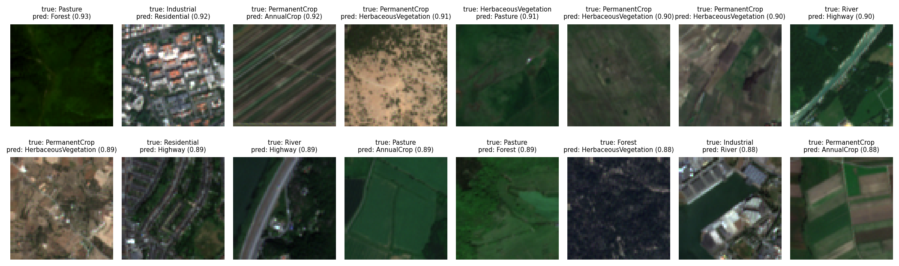</p>
<p align="center"><sub>The 16 most confident errors of the 13-band ResNet-18: mostly overlapping crop and vegetation classes, or patches that contain two classes.</sub></p>

## Findings

**1. The extra bands fix a physical confusion.** The most frequent error of the RGB network is dense forest predicted as water (29 of its 122 errors). Both are dark in the visible range, but in the near infrared forest is bright and water is black. With all 13 bands the errors drop from 122 to 70 (−43%), and this confusion disappears.

<p align="center">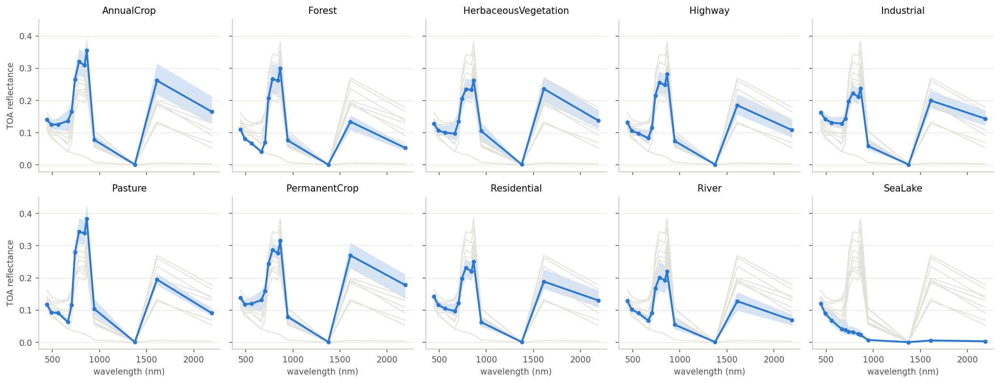</p>

**2. Hand-crafted features are good but blind to structure.** The SVM reaches 95.31%, but recognizes only 81.5% of the Highway patches (CNN: 99.2%): a thin road covers a small part of the patch, so global statistics and direction-averaged texture cannot capture it.

**3. The random split hides how much models differ.** On the random split the median test patch has a training patch 1.2 km away. On the geographically disjoint test region, OA drops by 2.5 points for the 13-band CNN, 6.1 for the RGB CNN and 7.6 for the random forest. The benefit of the extra bands grows from 43% to 55% fewer errors: the forest-as-water confusion of the RGB model grows from 29 to 112 errors.

<p align="center">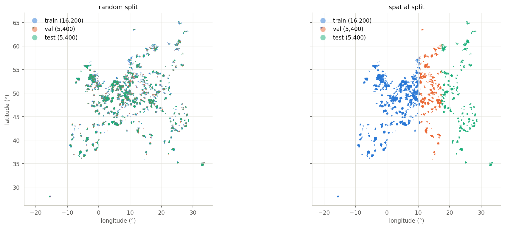</p>
<p align="center"><sub>Left: the standard random split, where test patches (green) sit right next to training patches (median distance 1.2 km). Right: the spatial split, where the test region lies east of 17.4° E (median distance to the nearest training patch 1,041 km).</sub></p>

<p align="center">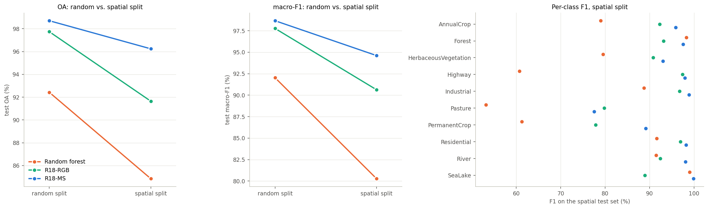</p>

**4. What the network uses.** Per-class band importance is physically plausible (SWIR and red edge for Forest and PermanentCrop, NIR for water). The four NIR bands look individually unimportant only because they are nearly identical (r ≥ 0.97). Bands designed for atmospheric correction (B01, B09, B10) rank among the important features of the random forest, a hint that acquisition conditions shared by neighbouring patches act as a shortcut under the random split.

<p align="center">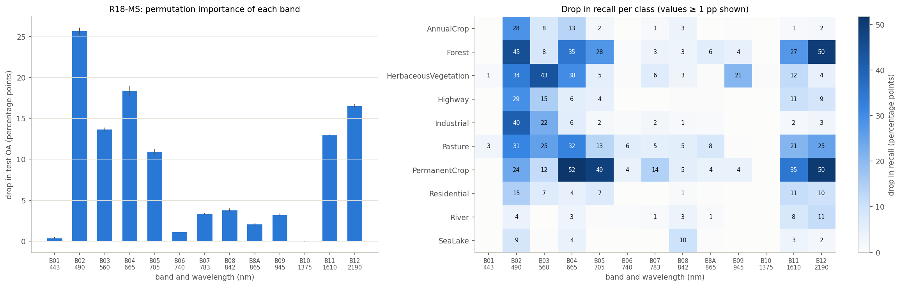</p>

Limitations (listed in the notebook): one training run per configuration, a spatial split that mixes autocorrelation with a regional shift, and permutation importance under correlated bands.

## Repository structure

```text
├── sentinel2_land_cover_classification.ipynb   # the whole project, with all outputs
├── figures/                                    # all figures of the notebook (PNG)
├── results/                                    # metrics, training histories, importances (CSV)
├── requirements.txt
└── data/, checkpoints/                         # created by the notebook, not part of the repository
```

## Getting started

```bash
git clone https://github.com/zahrayazdanice/Sentinel2-Land-Cover-Classification.git
cd Sentinel2-Land-Cover-Classification
pip install -r requirements.txt
jupyter notebook sentinel2_land_cover_classification.ipynb
```

The notebook downloads the multispectral EuroSAT release (2.07 GB, MD5-checked) and the two split definitions from the TorchGeo mirror on Hugging Face. A CUDA GPU is recommended. Setting the environment variable `QUICK_RUN=1` runs the whole pipeline on 10% of the data with one epoch per network, as a two-minute check.

